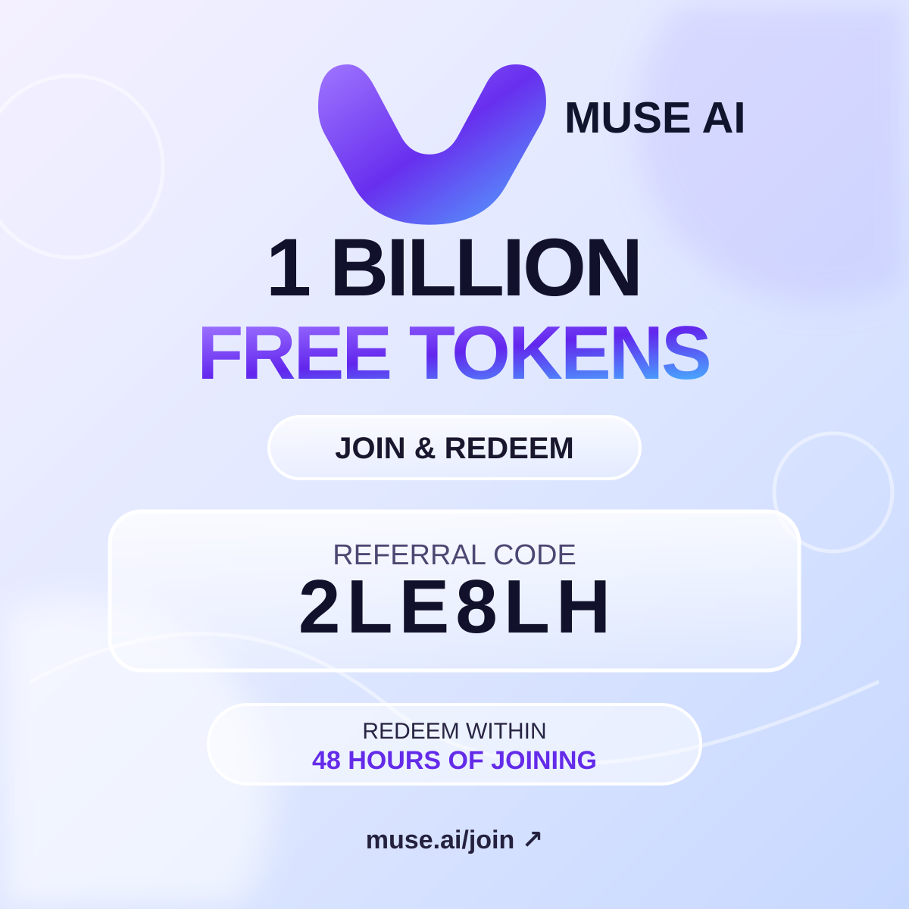

# Muse AI — 1 Billion Free Tokens

**Join Muse AI and redeem the referral code within 48 hours of creating your account.**

---

## 🎁 Referral offer

The invitation shared by the repository owner advertises **1 billion Muse tokens for both the person inviting and the person joining**. The code must be redeemed within 48 hours after joining. Eligibility and reward fulfillment are subject to Muse's current rules and terms.

| Detail | Information |
| --- | --- |
| Referral code | **`2LE8LH`** |
| Join link | https://muse.ai/join |
| Redemption window | Within **48 hours** of joining |
| Advertised reward | **1 billion Muse tokens** |

## 🚀 How to redeem

1. Open [Muse AI](https://muse.ai/join).
2. Create your account.
3. Open **Settings** in your Muse account.
4. Find the referral-code or redemption option.
5. Enter **`2LE8LH`** and submit it.
6. Complete redemption within **48 hours of joining**.

> **Tip:** Copy the code exactly: `2LE8LH`

## 🔗 Official link

- **Join Muse:** https://muse.ai/join

## ⚠️ Disclaimer

This is an independent community referral guide and is **not affiliated with, endorsed by, or an official repository of Muse**. The token amount and eligibility are based on the referral invitation shared by the repository owner. Rewards, redemption steps, and availability may change; check Muse's official terms and in-app information before participating.

---

**Explore. Create. Build with AI.**

